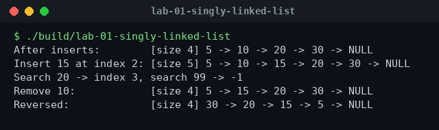
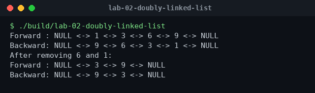
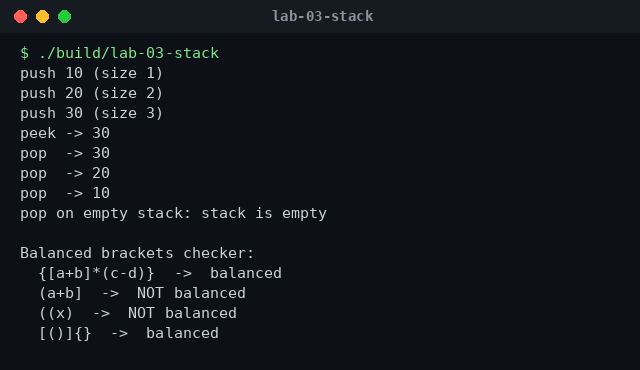
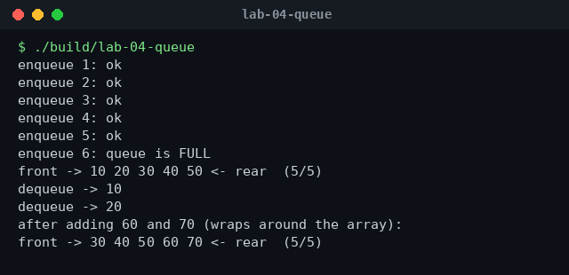
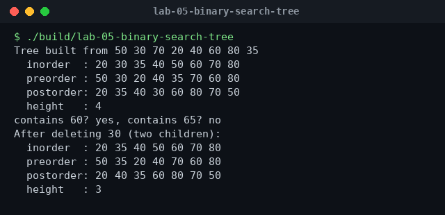
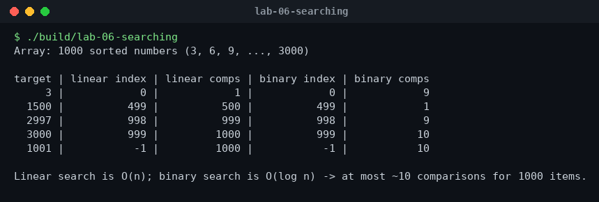
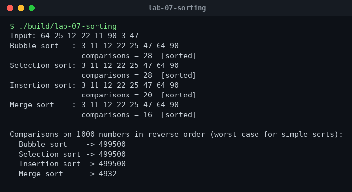

# Data Structures Lab (C++)


My Data Structures (Theory + Lab) work from the BS Software Engineering program at Superior University. Every data structure is written **from scratch** in C++ (no STL containers for the structure itself) so I could understand exactly how it works in memory.

## Labs

| Lab | Topic | What is implemented |
|-----|-------|---------------------|
| [Lab 01](lab-01-singly-linked-list/) | **Singly linked list** | insert head/tail/position, delete, search, in-place reverse |
| [Lab 02](lab-02-doubly-linked-list/) | **Doubly linked list** | push front/back with a tail pointer, delete, forward & backward traversal |
| [Lab 03](lab-03-stack/) | **Stack** | template stack on a linked list + balanced-brackets checker |
| [Lab 04](lab-04-queue/) | **Queue** | circular-array queue with overflow handling and wrap-around |
| [Lab 05](lab-05-binary-search-tree/) | **Binary Search Tree** | insert, search, delete (all 3 cases), in/pre/post-order, height |
| [Lab 06](lab-06-searching/) | **Searching** | linear vs binary search with comparison counts |
| [Lab 07](lab-07-sorting/) | **Sorting** | bubble, selection, insertion and merge sort with comparison counts |

## Build and run

Run every lab at once:

```bash
./build_all.sh
```

Or compile a single lab:

```bash
g++ -std=c++17 -Wall lab-05-binary-search-tree/main.cpp -o bst
./bst
```

## Big-O cheat sheet

| Structure / Algorithm | Access | Search | Insert | Delete | Notes |
|---|---|---|---|---|---|
| Singly linked list | O(n) | O(n) | O(1) at head | O(n) | O(n) insert at tail without a tail pointer |
| Doubly linked list | O(n) | O(n) | O(1) at head/tail | O(1) once the node is found | extra memory for `prev` |
| Stack | O(n) | O(n) | O(1) push | O(1) pop | LIFO |
| Queue (circular array) | O(n) | O(n) | O(1) enqueue | O(1) dequeue | FIFO, fixed capacity |
| Binary search tree | – | O(log n) avg / O(n) worst | O(log n) avg / O(n) worst | O(log n) avg / O(n) worst | worst case when the tree becomes a chain |

| Algorithm | Best | Average | Worst | Extra space | Stable |
|---|---|---|---|---|---|
| Linear search | O(1) | O(n) | O(n) | O(1) | – |
| Binary search | O(1) | O(log n) | O(log n) | O(1) | – (needs sorted data) |
| Bubble sort | O(n) | O(n²) | O(n²) | O(1) | yes |
| Selection sort | O(n²) | O(n²) | O(n²) | O(1) | no |
| Insertion sort | O(n) | O(n²) | O(n²) | O(1) | yes |
| Merge sort | O(n log n) | O(n log n) | O(n log n) | O(n) | yes |

My own measurement (lab 07): on 1000 numbers in reverse order, bubble/selection/insertion sort each made **499,500** comparisons while merge sort made only **4,932**.

## Sample output

**Singly linked list**



**Doubly linked list**



**Stack**



**Queue**



**Binary Search Tree**



**Searching**



**Sorting**



## Author

**Dhia Alhaq Saleh Al-Hindrish** — BS Software Engineering, Superior University, Lahore
GitHub: [@dhiaalhaq7979](https://github.com/dhiaalhaq7979)
